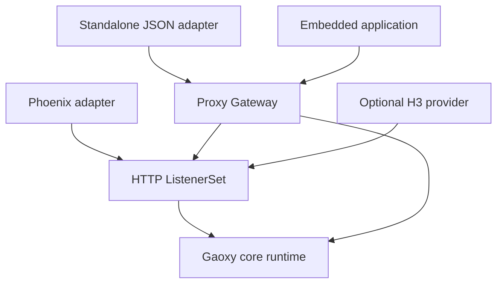
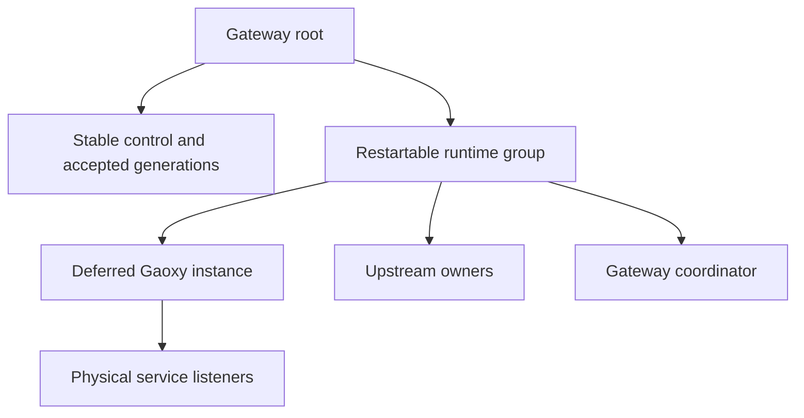

# Gaoxy: Unified Phoenix H1/H2/H3 and an Embeddable Gateway Runtime

## Status, authority, and outcome

- Agent Note project: `gaoxy`.
- Repository: https://github.com/gsmlg-dev/gaoxy.
- Reviewed source: `main` at `ec1fead80884804de9ab662e311ebb9c1cfdaf60`, inspected on 2026-10-21, Asia/Shanghai. The source declares Gaoxy 0.5.5; this commit refreshes dependencies after the previously reviewed `0a0f9d195db688719d9000abc1bb4915341c61d5` without changing the relevant library implementation.
- Document class: architecture decision proposal, implementation plan, and self-contained Codex execution handoff.
- Status: the user selected the two product goals below and requested an executable design. New modules, options, and APIs in this document are proposed implementation contracts. They are not claims of implemented, tested, released, or deployed behavior.
- This authoring task saves the design. It does not modify the repository or execute the implementation.

Implement two connected outcomes:

1. One Phoenix Endpoint can configure and own HTTP/1.1, HTTP/2, and HTTP/3 through `Gaoxy.PhoenixAdapter`, with one coherent lifecycle and one application target.
2. Applications can embed the same gateway runtime used by the standalone release, including managed upstream resources, route generations, reload, recovery, and shutdown, without depending on `gaoxy_server` or reproducing its resource orchestration.

Reconcile this plan with the actual checkout before editing. Preserve newer fixes; do not reset the repository to this review baseline.

## 1. Existing implementation and the architectural gap

The current package direction is useful and remains intact:

| Application | Existing responsibility | Responsibility after this work |
|---|---|---|
| `gaoxy` | Common transport instances, services, admission, lifecycle, Hell/Abyss integration | Same responsibility, with a supported generic staged-start contract |
| `gaoxy_http` | H1/H2, common HTTP endpoint/request interfaces, Plug/Phoenix, routing/generations | Also owns the common ListenerSet declaration, provider contract, and composition entry point |
| `gaoxy_http3` | Optional H3 implementation over QUIC | Supplies the H3 implementation of the common listener provider contract |
| `gaoxy_proxy` | Proxy endpoints, relays, upstream transports/groups, cleanup ownership | Also owns the complete reusable Gateway runtime |
| `gaoxy_server` | JSON/release entry point plus gateway orchestration | JSON/environment/CLI/readiness adapter around public Gateway APIs |

Observed source facts:

1. `Gaoxy.PhoenixAdapter.child_specs/2` only considers `http` and `https`, and always calls the H1/H2 `Gaoxy.HTTP.service_spec/1`. [Phoenix adapter](https://github.com/gsmlg-dev/gaoxy/blob/ec1fead80884804de9ab662e311ebb9c1cfdaf60/apps/gaoxy_http/lib/gaoxy/phoenix_adapter.ex)
2. `Gaoxy.HTTP.HTTP3.service_spec/1` already produces a core QUIC service. The missing piece is common composition and ownership at the user-facing boundary. [H3 service](https://github.com/gsmlg-dev/gaoxy/blob/ec1fead80884804de9ab662e311ebb9c1cfdaf60/apps/gaoxy_http3/lib/gaoxy/http/http3.ex)
3. External mounting of an already server-enabled Phoenix Endpoint is rejected by `PlugEndpoint`; retain that ownership protection. [PlugEndpoint](https://github.com/gsmlg-dev/gaoxy/blob/ec1fead80884804de9ab662e311ebb9c1cfdaf60/apps/gaoxy_http/lib/gaoxy/http/plug_endpoint.ex)
4. Standalone resource orchestration lives in `Gaoxy.Server.RouteResources`, `UpstreamSupervisor`, and related supervisor/config modules. `UpstreamSupervisor` replaces a core child start function and calls `Gaoxy.Instance.start_link` with an internal deferred flag. [RouteResources](https://github.com/gsmlg-dev/gaoxy/blob/ec1fead80884804de9ab662e311ebb9c1cfdaf60/apps/gaoxy_server/lib/gaoxy/server/route_resources.ex), [UpstreamSupervisor](https://github.com/gsmlg-dev/gaoxy/blob/ec1fead80884804de9ab662e311ebb9c1cfdaf60/apps/gaoxy_server/lib/gaoxy/server/upstream_supervisor.ex)
5. `Gaoxy.Instance` derives its drain cap from the complete initial service list. Deferred startup currently delays service creation but preserves that cap. Later `add` rejects a service whose drain budget exceeds it. Starting an empty instance with default budgets changes existing behavior. [Instance](https://github.com/gsmlg-dev/gaoxy/blob/ec1fead80884804de9ab662e311ebb9c1cfdaf60/apps/gaoxy/lib/gaoxy/instance.ex)
6. `Router.compile/1` calls endpoint initialization and generates a reference. Existing HTTP service builders can also initialize targets through option validation. They cannot simply be relabeled as pure declaration compilers. [Router](https://github.com/gsmlg-dev/gaoxy/blob/ec1fead80884804de9ab662e311ebb9c1cfdaf60/apps/gaoxy_http/lib/gaoxy/http/router.ex), [HTTP options](https://github.com/gsmlg-dev/gaoxy/blob/ec1fead80884804de9ab662e311ebb9c1cfdaf60/apps/gaoxy_http/lib/gaoxy/http/options.ex)
7. Route generations already provide immutable request snapshots and expected-generation activation. Build on this machinery and its resource accounting. [Generation](https://github.com/gsmlg-dev/gaoxy/blob/ec1fead80884804de9ab662e311ebb9c1cfdaf60/apps/gaoxy_http/lib/gaoxy/http/generation.ex)

These facts were established by source inspection. No implementation tests were executed while writing this note.

## 2. Scope and design decisions

### Required outcomes

- Keep the five applications and their acyclic dependency direction.
- Add a common HTTP listener-composition API without changing existing single-service API return shapes.
- Add an explicitly enabled H3 listener to the existing Phoenix adapter.
- Give applications one public Gateway child specification for the complete reusable gateway lifecycle.
- Share a route generation across the physical listeners of one explicitly declared logical ListenerSet.
- Preserve accepted configuration across restart of a gateway's runtime/upstream-owner subtree.
- Preserve cleanup ownership, resource reservations, deadlines, and existing protocol restrictions.
- Keep the standalone JSON v1 contract and existing local reload entry point compatible.

### Explicit non-goals

- Renaming packages, merging applications, splitting a new mandatory gateway application, or moving repositories.
- Rewriting H1/H2/H3 engines, replacing Hell/Abyss, or performing a broad HTTP abstraction cleanup.
- Implementing cleartext mixed H1/h2c detection or HTTP/1 Upgrade-to-h2c. That is a separate connection-selection task; preserve or integrate any newer implementation already present in the checkout.
- New QUIC address-family, migration, 0-RTT, QPACK, mTLS, WebTransport, or proxy-protocol capabilities.
- A distributed control plane, durable configuration database, public management API, automatic certificate issuance, or live listener/certificate reconfiguration.
- Transactions across multiple independent ListenerSets or gateways.
- Restoring runtime state after complete gateway-supervisor loss or VM restart beyond the host's existing configuration/startup behavior.

### Decisions

| ID | Decision | Reason |
|---|---|---|
| D1 | Add `Gaoxy.HTTP.ListenerSet` in `gaoxy_http` | Phoenix and gateways need the same composition contract |
| D2 | Define the listener provider behaviour in `gaoxy_http`; implement H3 in `gaoxy_http3` | Preserve optional H3 without a reverse package dependency |
| D3 | Add explicit Endpoint-level `http3:` beside existing `http:` / `https:` | Keep transport and existing defaults unambiguous |
| D4 | Add `Gaoxy.Proxy.Gateway` inside `gaoxy_proxy` | Reuse standalone orchestration in embedded applications |
| D5 | Separate input declaration, accepted materialized declaration, and process-bound prepared resources | Make recovery and configuration acceptance precise |
| D6 | Expose supported staged startup through core APIs | Remove host calls to private Instance startup and retain budgets |
| D7 | Preserve existing resource/generation algorithms while moving ownership | Limit the behavioral risk of this architecture change |

## 3. Architecture and ownership

### 3.1 Dependency boundaries



The arrows show compile-time/API dependencies. The HTTP layer invokes an explicitly enabled H3 provider through its public callback contract at runtime. It must not gain a Mix dependency on `gaoxy_http3`, including an optional back-edge. `gaoxy_http3` already depends on `gaoxy_http`.

Core must not reference HTTP, Proxy, Phoenix, or Server modules. HTTP must not reference Proxy or Server. New Proxy Gateway modules must not reference `Gaoxy.Server.*`.

### 3.2 Distinguish the three representations

| Representation | Contents | Lifetime |
|---|---|---|
| Pure input Plan | Stable IDs, uninitialized target declarations, listener settings, route declarations, resource policies, source file references, finite budgets | Reusable before any runtime exists |
| Accepted declaration | Owner-independent normalized values plus accepted external-material snapshots, such as upstream CA data, and a logical configuration revision | Survives runtime-owner subtree restart within the gateway |
| Prepared runtime state | PIDs, owner epoch, upstream handles, preparation/baseline pins, initialized endpoints, compiled Router, runtime generation, readiness | Valid only for its owning runtime epoch |

Pure compilation must not bind sockets, start processes, read files, perform DNS/network I/O, allocate runtime references, or call user `init` callbacks. It must not return a compiled Router or prepared resource handle. Preserve original target configuration separately from any initialized target state.

Provider loading/capability checks, certificate/trust materialization, endpoint initialization, and resource creation belong to bounded preparation. They must finish or fail before listeners are reported ready.

An upstream trust file accepted during preparation must be represented by its accepted immutable contents for owner recovery. Re-reading a modified file must require a new explicit preparation/reload; it must not silently change the accepted upstream policy during recovery. Listener certificate changes continue to require explicit restart under the existing behavior.

Existing low-level APIs may retain their documented advanced option forms. New declarative plans must not accept live Gaoxy handles as reusable declarations or invent an implicit serialization guarantee for arbitrary low-level Plug state.

## 4. Common HTTP ListenerSet

### 4.1 Public contract

Introduce the following contract in `gaoxy_http`. Names may be aligned with repository conventions in the initial interface commit, but subsequent workers must use one agreed interface.

| API | Required behavior |
|---|---|
| `Gaoxy.HTTP.ListenerSet.plan/1` | Return a pure normalized Plan or structured field-level validation errors |
| `Gaoxy.HTTP.ListenerSet.child_spec/1` | Offer direct embedding of one logical set with one core instance |
| `Gaoxy.HTTP.ListenerSet.start_link/1` | Start and supervise the set; succeed only after all required listeners are ready |
| `Gaoxy.HTTP.ListenerSet.info/1` | Return logical status and actual physical listener addresses/protocols/capabilities |
| Internal prepare/materialize contract | Allow a caller-owned runtime, including Gateway, to obtain finalized service specs and ownership metadata without creating a second core instance |

Preserve `Gaoxy.HTTP.service_spec/1`, `Gaoxy.HTTP.HTTP3.service_spec/1`, and their single-listener entry points. A single-service builder must not start returning a list after this change.

A ListenerSet Plan contains: a stable logical `id`; one uninitialized application target; listener declarations keyed by role; stable role-to-core-service ID mapping; optional discovery policy; and the complete shutdown/resource budget. It contains no socket, PID, reference, ETS table, initialized endpoint, Generation store, or prepared upstream capability.

Role IDs must respect the actual core ID contract, currently non-nil atoms or bounded strings. Do not assume tuple service IDs are already supported. Preserve existing Phoenix HTTP/HTTPS IDs. Use bounded, collision-checked string IDs for dynamically configured sets; never create atoms from JSON or arbitrary user identifiers.

### 4.2 Provider contract

Define a small behaviour such as `Gaoxy.HTTP.ListenerProvider` in `gaoxy_http`. Its responsibilities are:

- Pure normalization of provider-specific option data.
- Explicit supported transport/capability metadata.
- Materializing a validated listener declaration and an internally prepared target into a core service specification.
- Reporting the runtime identity required for actual address/readiness observation through public core APIs.

Materialization must not bind a socket. H1/H2 use an implementation in `gaoxy_http`; H3 supplies its implementation from `gaoxy_http3`.

Only resolve/load the H3 provider when H3 is explicitly enabled. Missing code must produce a clear `{:missing_optional_dependency, :gaoxy_http3}`-style error before any listener binds. An H1/H2-only external consumer must compile and run without the H3 package or QUIC engine. Use a fixed, allowlisted mapping of provider identifiers, with callback/version checks; do not build a global plugin registry or evaluate module names from JSON.

Split pure option normalization from target initialization where current builders mix them. Reuse initialized target state through an internal prepared-target contract; callers must not be able to set an arbitrary `initialized: true` or endpoint-managed flag through JSON to skip validation.

### 4.3 Startup and readiness

1. Normalize the complete set and detect same-transport binding conflicts.
2. Preflight all explicitly enabled providers, fixed settings, capabilities, target initialization, and budgets.
3. Create the correctly budgeted runtime and any explicitly owned preparation state.
4. Materialize all final service specs, validate the final set, and activate them under one owned startup operation.
5. Obtain actual bound addresses for every required listener.
6. Publish ready state and discovery only after the whole required set is ready.

If any required bind/start fails, stop all listeners and owned resources created by that startup. Keep ownership until cleanup is confirmed or report cleanup-pending uncertainty. A caller timeout is not proof that a late listener did not start.

Sequential TCP/UDP binds are not an OS-level atomic network transaction. This design guarantees an honest startup result, complete rollback ownership, and no early readiness/discovery publication. It does not claim that a listener can never be briefly reachable while another socket is being bound.

Do not fake staged activation by calling generic pause/resume: TCP/TLS pause unbinds/rebinds, UDP pause controls admission, and the current QUIC host does not provide equivalent pause semantics. Preserve per-service capability reporting.

After successful startup, an individual H3 service may recover while H1/H2 remain available. Report the set as degraded and withdraw H3 discovery until the current H3 service incarnation is ready. A Gateway upstream-owner failure has the broader runtime recovery behavior defined in section 7.

## 5. Phoenix integration

### 5.1 Configuration

Keep `adapter: Gaoxy.PhoenixAdapter`. Preserve existing `http:` and `https:` meaning, defaults, option validation, and protocol selection. Add a sibling `http3:` keyword configuration.

| Configuration | Contract |
|---|---|
| `http3: nil` or `false` | H3 disabled; old behavior preserved |
| Explicit `http3:` keyword list | Enable the H3 member of the Endpoint's ListenerSet |
| `http3: true` | Reject in this implementation; no implicit bind/certificate inference |
| `https.protocols` | Continues to describe H1/H2 over TCP/TLS only |
| H3 bind and credentials | Explicit `ip`, `port`, `certfile`, and `keyfile` in the initial supported interface |
| H3 limits | Existing `limits`, `http_limits`, `h3_limits`, and explicit `extended_connect` validation |

Do not copy TCP ALPN/version settings into QUIC. QUIC H3 uses its own TLS/ALPN configuration. Retain current H3 limitations: unsupported wildcard/IPv6 bindings and unsupported TLS capabilities fail clearly; do not silently change the bind address, weaken validation, or disable H3 and continue.

Two explicit equal nonzero port numbers mean TCP HTTPS and UDP H3 share the numeric port. Different nonzero ports are also supported. Independently configured port zero listeners may bind independently and must report their separate actual ports. Coordinated same-number ephemeral TCP/UDP allocation is outside this implementation: do not imply that two zero ports will become one port, and reject any explicit same-port request that requires such coordination. No port scanning or unbounded retries.

Proposed configuration example after implementation; both secure listeners use the same Endpoint and numeric port:

```elixir
config :my_app, MyAppWeb.Endpoint,
  adapter: Gaoxy.PhoenixAdapter,
  server: true,
  http: false,
  https: [
    ip: {127, 0, 0, 1},
    port: 8443,
    certfile: "priv/cert/selfsigned.pem",
    keyfile: "priv/cert/selfsigned_key.pem",
    protocols: [:http2, :http1]
  ],
  http3: [
    ip: {127, 0, 0, 1},
    port: 8443,
    certfile: "priv/cert/selfsigned.pem",
    keyfile: "priv/cert/selfsigned_key.pem"
  ]
```

The host application explicitly includes `gaoxy_http3` when using this configuration. The adapter maps the new top-level H3 certificate options into the provider's existing TLS representation. Use suitable certificates and an explicit supported address for the actual deployment; the loopback example is for local verification.

### 5.2 Endpoint ownership and target initialization

`child_specs/2` must construct one ListenerSet owner for an Endpoint; that owner must create exactly one core instance containing the configured HTTP/HTTPS/H3 services. Do not start one core instance per protocol. Preserve existing core instance registration where callers currently rely on it.

If all three listener configurations are absent or disabled, preserve `child_specs/2 == []`; do not start an empty owner merely because the new composition API exists.

All members must use the same target construction path:

- The actual Phoenix Endpoint module.
- The existing `Phoenix.Endpoint.SyncCodeReloadPlug` wrapping rule when code reload is enabled.
- The same `Gaoxy.PhoenixWebSocket` integration and exact allowed socket paths.
- Existing H1 WebSocket Upgrade behavior.
- Explicit H2 and H3 extended-CONNECT enablement and validation.

Initialize a shareable application target once per set preparation; keep connection-, request-, protocol-, and resource-specific state separate. Repeated validation of a prepared spec must not accidentally re-run target initialization or allocate another resource owner.

Retain the external duplicate-listener guard. Adapter-owned preparation may use a controlled internal endpoint-managed contract. External mounting of a `server: true` Endpoint remains an error. `server: false` still disables adapter-owned listeners and supports the established explicit external embedding mode.

### 5.3 Inspection and public origin

Preserve `Gaoxy.PhoenixAdapter.server_info(endpoint, :http)` and `server_info(endpoint, :https)`, including return shape, errors, and their existing TCP meaning.

Add a transport-aware `listeners(endpoint)` query that includes role, transport, actual address/port, protocols, state, and relevant lifecycle capability limits. H3-only operation must not pretend a TCP HTTPS listener exists. Phoenix `url` remains the application's public-origin setting; it is not inferred from ephemeral socket metadata.

## 6. Optional HTTP/3 discovery

Implement readiness-aware Alt-Svc as an explicit ListenerSet option, disabled by default for backward compatibility. HTTP/3 may be advertised using an HTTP response header; the client remains responsible for transport selection. See [RFC 9114 section 3.1.1](https://www.rfc-editor.org/rfc/rfc9114.html#section-3.1.1) and [RFC 7838 section 3](https://www.rfc-editor.org/rfc/rfc7838.html#section-3).

Scope the first implementation to the same origin host. Configuration selects either the actual bound UDP port or an explicit public UDP port, and a finite cache lifetime, initially 60 seconds. Do not derive a new authority from an unchecked Host header or assume the TCP and UDP ports are equal.

When enabled, the ListenerSet owns its Alt-Svc field. Prepare the header at the common final-response boundary before header budget/accounting checks. Cover Plug, native Endpoint, proxy, normal, file, and streamed response paths on secure H1/H2. Do not implement this exclusively as a Plug callback or as an H2-only frame. Skip informational and protocol-upgrade responses.

Avoid duplicate/conflicting upstream Alt-Svc values when the gateway manages the field. With the option disabled, retain prior header behavior.

Emit a positive advertisement only after complete startup and while the current H3 incarnation is observed ready at header preparation. Late events from an old incarnation must not re-enable advertisement. During observed H3 loss, drain, or recovery, suppress it; any deliberate `clear` policy must be documented. Readiness can change after a header is prepared, so this is not network-atomic revocation. Previously cached alternatives can remain valid until their cache lifetime expires. Do not claim that stopping the listener immediately revokes client caches or that observing an H3 page proves H3 WebSocket usage.

## 7. Reusable Proxy Gateway

### 7.1 Public API and responsibilities

Implement `Gaoxy.Proxy.Gateway` within `gaoxy_proxy`.

| API | Required contract |
|---|---|
| `Gateway.compile/1` | Pure input normalization into an owner-independent Gateway Plan |
| `Gateway.child_spec/1` | Named or unnamed embedding with an explicit child ID; normal stop must not immediately resurrect the instance |
| `Gateway.start_link/1` | Start a complete gateway and return its stable root PID/reference after readiness |
| `Gateway.info/1` | Phase, logical sets, actual listeners, accepted configuration revisions, runtime epochs, and observable cleanup state |
| `Gateway.reload_routes(gateway, set_id, declaration, opts)` | Replace routes of one set, requiring `expected_revision` against accepted configuration and a finite `timeout`; listener settings stay fixed |
| `Gateway.operation_status/2` | Reconcile an operation whose completion reply was lost or timed out |
| `Gateway.stop/2` | Stop the gateway under one total deadline; return success only after confirmed cleanup |

The Gateway accepts ListenerSet plans and the existing supported raw services. It owns one core instance for its configured service domain. It consumes ListenerSet preparation/activation contracts rather than starting an additional ListenerSet-owned core instance for every set.

High-level callers must not need to orchestrate transport preparation, baseline pins, group handles, or custodian completion themselves. Existing low-level APIs remain available.

### 7.2 Module migration

| Existing responsibility | Target |
|---|---|
| `Server.RouteResources` resolve/prepare/activate, pending-pin cleanup, owner monitoring | `Proxy.Gateway.Coordinator` and focused preparation helpers |
| `Server.UpstreamSupervisor` | `Proxy.Gateway.RuntimeSupervisor` |
| JSON-independent upstream declarations and resource policy from `Server.UpstreamEndpoint` | `Proxy.Gateway.Declaration` / resource-plan helpers |
| General generation/runtime ownership from `Server.Supervisor` | Gateway supervisor |
| JSON field/enum conversion, file loading/limits, handler allowlist | Remain in `Server.Config` and `Server.RouteConfig` |
| Environment variables, readiness output, release/application integration | Remain in `Server.Application` |
| Legacy standalone registration names and reload facade | Remain in Server wrappers, passed explicitly as host options |

Move behavior with its tests and invariants. Do not copy the full implementation and leave two independent resource orchestrators. Keep small forwarding wrappers only where compatibility requires them. Echo/static built-in module placement is not a prerequisite for this extraction.

### 7.3 Supervisor and failure domains



Keep accepted generation stores ahead of the runtime subtree, following the useful existing rest-for-one ordering. A runtime/owner failure invalidates its instance-bound handles and restarts the common runtime group. Preserve the existing one-for-all recovery scope within one Gateway unless a smaller change demonstrably preserves its invariants.

One logical ListenerSet has one shared Generation store for its H1/H2/H3 listeners. Do not activate separate stores sequentially and call that an atomic set reload. Preserve per-protocol request accounting while sharing the logical route snapshot.

Two gateways may use identical set/service IDs on different bindings. Their runtime names, stores, owners, operation receipts, and readiness must remain isolated. Use PIDs, explicit registrations, and namespaced registry keys; no dynamic atoms from configuration.

Retain existing independent cleanup guardians/custodians where their lifetime intentionally outlives a failed instance subtree. Moving code must not shorten their lifetime or discard completion receipts.

### 7.4 Supported core staged startup

Expose a validated generic core option such as `activation: :deferred`, keeping immediate activation as the existing default. The full planned service set and its derived shutdown cap must remain available to the startup owner before binding. Do not implement this as an empty default-budget instance.

Provide a public, bounded activation operation for the finalized services, either a focused batch activation API or an equivalently explicit deadline-aware public contract agreed in the interface commit. Its required semantics are fixed:

- Finalize and validate the entire service set before the first bind.
- Retain planned IDs, transport/bind declarations, and resource/shutdown ceilings; preparation may bind instance-specific target/resource state but cannot silently widen those ceilings.
- Carry one absolute deadline through sequential startup work rather than restarting a full timeout per listener.
- An owned operation, rather than the requesting caller, retains late completions and rollback responsibility after timeout or caller death.
- Return actual activation outcome or a reconcilable pending/unknown outcome; never retry an ambiguous add blindly.
- Roll back all services created by failed initial activation and preserve cleanup-pending state until confirmation.

The internal deferred flag currently only suppresses initial creation, and public `Gaoxy.add/2` uses its own call timeout. Exposing the flag alone is insufficient. Keep this extension generic: core must not know about Endpoint modules, routes, H3, or proxy groups. Server and Gateway must stop calling `Gaoxy.Instance.start_link` or replacing a child specification's start function with private startup.

### 7.5 Startup order

1. Compile declarations and validate logical IDs, providers, bindings, and budgets.
2. Prepare external material and create stable stores/control state.
3. Start the deferred, correctly budgeted core instance through the supported API.
4. Create instance-bound upstream owners under the gateway runtime group. Register lifecycle/cleanup ownership with the staged instance before allocating upstream resources.
5. Materialize each set's accepted declaration: prepare upstream resources, obtain preparation pins, initialize targets, and compile the runtime Router.
6. Have the shared generation store acquire its baseline resources and commit the active Router with its matching accepted declaration.
7. Release preparation pins; keep unconfirmed cleanup owned and bounded.
8. Activate all required physical services through the common ListenerSet/core contract.
9. Confirm actual addresses and publish complete readiness.

Failure at any stage must clean up the ownership already established. Previously prepared resources must not become orphaned because a later provider, certificate, target initialization, or bind fails.

### 7.6 Route reload and commit ambiguity

Reload applies to one logical set and does not change transport, bind, certificate, or listener-limit settings. Route/upstream settings already supported by reload remain supported.

Use one finite deadline and require `expected_revision` against the accepted configuration revision in the new Gateway API. Keep legacy runtime-generation mapping in the compatibility facade. Allocate the operation identity in the public wrapper before sending the request, so a lost admission/commit reply can still return that identity for reconciliation. A caller may supply an operation identity to reconcile its own interrupted call; the authority must reject conflicting reuse rather than silently execute a different payload.

A bounded preparation step materializes candidate external inputs, prepares new upstream handles/pins, and compiles the candidate Router outside the generation store's short commit path. Every prepared candidate records its preparing runtime epoch as well as its expected accepted revision.

The generation store performs one authoritative transition that:

1. Checks the expected accepted revision, current runtime epoch, lifecycle phase, and deadline.
2. Acquires the candidate baseline resources.
3. Changes the active Router.
4. Records the matching accepted declaration and logical configuration revision.
5. Records the operation's commit result.

Do not update an active Router in one process and then separately persist its desired declaration in another. Recovery must never observe a mismatched pair.

Existing requests retain their selected Router and request pins. Requests capturing a snapshot after the commit use the new generation, regardless of whether they arrive over H1, H2, or H3. Concurrent requests on opposite sides of the commit may legitimately observe different generations; do not promise identical results for all simultaneously executing requests.

Separate accepted configuration revision from runtime materialization epoch. Rebuilding resources after owner loss does not accept a different configuration. Preserve compatibility mappings where the legacy facade returns a runtime generation token.

A candidate prepared before owner recovery must be rejected if its runtime epoch is stale, even when the accepted revision has not changed. It cannot install old-owner handles into the rematerialized runtime.

Allow at most one in-flight reload per logical set initially and retain bounded receipts, at least the in-flight operation and most recent terminal result. A timeout after submission returns the operation identity and an honest pending/unknown outcome. Status can report committed, rejected, pending, or unknown. Eviction or loss of the authority is unknown, not proof of rejection. Reconcile before retrying an ambiguous operation.

Commit success means the candidate became active. It does not mean every old request and retired resource has finished. Keep pending preparation/retirement cleanup observable and owned. Reuse the existing generation/resource machinery rather than building a general transaction framework.

### 7.7 Recovery

On upstream-owner/runtime-group failure, withdraw ready/discovery state for affected listeners, invalidate old handles by owner epoch, and rebuild from the latest accepted declaration retained outside that subtree. Preserve accepted trust snapshots. Do not restore the startup JSON over a later successful reload, and do not use stale or rejected candidate declarations.

Recreate the core instance and upstream owners, rematerialize handles, establish generation baselines, then restore listeners and readiness. After recovery, another reload must work; stale pins from old owner incarnations must not block it.

The failure domain may remain the whole configured service domain within one Gateway. A failure in Gateway A must not restart, alter routes in, or stop Gateway B.

### 7.8 Shutdown and cancellation

Transition stable control state to draining before stopping the runtime. Reject new reload/preparation, withdraw ready/discovery, close new admission, and use one absolute deadline for listeners, admitted requests, lifecycle participants, and upstream cleanup.

Serialize a stop barrier against each set's authoritative commit path. A reload committed before that barrier retains its honest committed receipt; uncommitted candidates are cancelled/discarded and their prepared resources remain owned until cleanup. Late preparation, commit, activation, or readiness completion after the barrier must not publish routes or recreate a listener. The barrier must cover an already in-flight operation, not only reject new requests.

Keep upstream owners available until the dependent request/custodian cleanup has completed or remains explicitly pending. Preserve existing transport-specific drain guarantees; this work does not upgrade QUIC host cleanup into a new protocol-level graceful-drain guarantee.

Successful stop terminates the Gateway root without automatic resurrection. Preserve transient/normal-stop semantics where required and ensure the restartable subtree respects the terminal draining phase. Do not let an intentional core stop trigger a fresh one-for-all runtime.

Use supervised lifecycle ownership for stop operations. Avoid a child synchronously stopping and waiting for the supervisor that must terminate that same child. Caller timeout or death must not orphan cleanup. Return `:ok` only for confirmed completion; bounded deadline errors retain cleanup-pending semantics and identify the owner that continues reconciliation.

## 8. Standalone compatibility

`Gaoxy.Server.Application` remains responsible for `GAOXY_CONFIG`, local JSON input, existing ready output, and application-stop integration. It starts Gateway through public APIs and obtains actual listeners through Gateway inspection.

Preserve `Gaoxy.Server.reload_routes(service_id, path, timeout)` as a compatibility facade: bound/read/decode the file, map the legacy service ID to its logical set, and call Gateway reload. Preserve existing successful return shapes where possible. If commit uncertainty must be exposed, document and test the additive error contract rather than reporting a false rejection.

JSON v1 keeps its current allowlists, defaults, limits, and interpretation. Its independent `http` and `http3` services remain independent logical sets. Never merge them merely because their port, route content, or certificates look similar. The standalone adapter may pass legacy registration names explicitly; reusable Proxy code must not embed those names.

Shared ListenerSets are available through the embedded API and Phoenix adapter in this work. A new public JSON grouping syntax is not required to complete the extraction. If a minimal additive syntax is included, specify version/validation and compatibility tests before implementation; do not silently change v1 meaning.

Update the JSON decoder to use the same semantic declaration normalization and resource-plan preparation as embedded inputs. JSON/file/enum handling stays in Server; routing and upstream lifecycle policy lives in the reusable libraries.

## 9. Implementation plan for Codex

### Phase 0 — Reconcile and freeze the contracts

- Inspect current `AGENTS.md`, branch/worktree status, current source, and scoped test runners.
- Reconcile new commits with the baseline and any concurrent H1/h2c work; preserve their assertions and changes.
- Record the architecture in `docs/designs/unified-listeners-embedded-gateway.md` and the implementation checklist in `docs/plans/unified-listeners-embedded-gateway.md`. These may be derived from this note and must remain consistent.
- Freeze ListenerSet Plan/provider contracts, core staged activation, Gateway APIs, operation outcomes, and compatibility rules before parallel edits.
- Identify one owner for `Gaoxy.HTTP.Generation`/Store and resource-accounting changes.

Exit: contracts are concrete enough that HTTP and Gateway workers do not invent different Plan, target, readiness, or revision representations.

### Phase 1 — Establish common foundations

Parallelize only independent ownership:

| Workstream | Owned area | Output |
|---|---|---|
| Core lifecycle | `apps/gaoxy` and scoped core tests | Validated deferred startup, complete budgets, bounded owned activation/rollback |
| HTTP composition | ListenerSet, provider interface, pure normalization, H3 provider | Common immutable declarations and prepared-target/service contracts |
| Gateway declarations | New Gateway declaration/resource-plan modules, JSON-independent extraction | Reusable input normalization and materialization separation |
| Generation semantics | A single designated worker for Generation/Store changes | Atomic accepted declaration/router/receipt contract and revision/epoch rules |

Do not have multiple workers independently modify Generation accounting. Integrate contract changes before starting dependent host adapters.

### Phase 2 — Implement the embedded Gateway

- Extract and parameterize RouteResources/UpstreamSupervisor behavior into Gateway.
- Implement stable stores, runtime-group recovery, complete startup rollback, reload, bounded outcome inspection, and stop.
- Remove private Instance startup and hardcoded Server names from reusable code.
- Prove two named/unnamed gateways can reuse the same logical IDs independently.
- Preserve and migrate existing generation, recovery, pin, and custodian assertions.

Exit: an external consumer depending on `gaoxy_proxy` can run and reload a managed gateway without loading `gaoxy_server`.

### Phase 3 — Integrate the hosts

After foundations are stable, these may proceed in parallel:

- Phoenix: add explicit `http3:`, one ListenerSet owner, common Endpoint/code-reload/WebSocket handling, and transport-aware inspection.
- Standalone: convert JSON/files to shared declarations, start Gateway, and preserve ready/reload/application-stop contracts.

Integrate optional Alt-Svc at the common response-header boundary and wire current-incarnation readiness into it. Keep the feature opt-in.

Exit: both requested product paths use shared library contracts; no duplicated standalone runtime remains active.

### Phase 4 — Verify, review, document, and complete

- Run focused unit and finite real-network tests for the concrete changes in section 10.
- Run required ordinary compatibility, formatting, compilation, package-isolation, and release checks from the current repository policy.
- Obtain independent specification/code review, resolve actionable findings, and run fresh affected verification after final changes.
- Update Phoenix/H3/gateway/standalone guides and runnable examples. Document public names/options, actual bindings, dependency selection, recovery scope, and remaining limitations.
- Follow the owner's standing completion workflow: scoped conventional commits, normal integration, push, and the established coordinated release process after required verification. Select the next available version using repository policy; do not hard-code a release number from this note. Keep publication outcomes separate from local verification. No production deployment is implied.

Continue through all phases. A written design or moved files alone do not complete this task. Preserve historical excluded pressure/slow-peer/extended qualification scope; do not reintroduce it as a new blocker for this architecture work.

## 10. Acceptance matrix

Use existing harnesses and independent protocol peers where available. Tests must verify externally meaningful behavior and ownership, not duplicate implementation structure. New API names below describe the required contracts, not pre-existing test filenames.

| ID | Scenario | Required evidence |
|---|---|---|
| A01 | Pure compilation | No socket/process/file I/O, endpoint init, runtime refs, or prepared handles; stable normalized result |
| A02 | Optional H3 absent | H1/H2 consumer builds/runs; explicit H3 fails before any bind with a clear missing-dependency error |
| A03 | Core-only consumer | Core remains independent of Plug/Phoenix/proxy/H3 dependencies |
| A04 | Deferred budget | No listener before activation; a valid drain budget above 5000 ms remains valid through activation and shutdown |
| A05 | Final set validation | Declaration-detectable duplicate IDs/bind conflicts fail preflight; OS-detected conflicts fail activation with rollback; TCP and UDP same numeric port remain allowed |
| A06 | Activation timeout/caller loss | Late bind completion remains owned and is reconciled/rolled back; no blind retry or orphan listener |
| H01 | One Phoenix Endpoint | Forced TLS H1, TLS H2, and QUIC H3 requests reach the same Endpoint/pipeline/route, with evidence of actual negotiated versions |
| H02 | Existing defaults/API | HTTP default H1, HTTPS default H2/H1, existing service builders, IDs, and server_info behavior preserved |
| H03 | Same numeric port | Nonzero TCP HTTPS and UDP H3 port match; occupying UDP causes startup failure and cleanup of the started TCP sibling |
| H04 | Independent ephemeral ports | Actual ports reported separately; no false same-port assertion or advertisement of zero |
| H05 | Preparation failures | Missing provider, invalid certificate, unsupported bind, and target-init failure produce no ready listeners or leaked preparation resources |
| H06 | Endpoint lifecycle | Stop/restart controls all listeners; external duplicate mount remains rejected; server:false remains supported |
| H07 | Phoenix integration | Existing H1 WebSocket works; enabled H2/H3 extended CONNECT honors exact paths; all protocols retain code-reload wrapping |
| H08 | Inspection | Queries distinguish TCP HTTPS and UDP H3; degraded/recovering state is visible |
| D01 | Discovery coverage | Opt-in header appears on secure H1/H2 Plug/native/proxy final responses, including streaming, with the correct actual/public UDP port |
| D02 | Discovery ownership | No duplicates; late old-incarnation events cannot re-enable advertisement; no insertion when disabled or H3 is observed unready at header preparation; header budgets still enforced |
| G01 | External embedded consumer | Managed gateway runs with `gaoxy_proxy` and its declared dependencies, without `gaoxy_server`; add H3 only for the H3 case |
| G02 | Two gateways | Same logical IDs work independently; reload, stop, or crash of one leaves the other unchanged |
| G03 | Shared logical routes | One set's H1/H2/H3 use one generation store; requests after a commit observe the new route while old in-flight work retains the old snapshot |
| G04 | Failed/stale candidate | Active and accepted declarations remain unchanged after prepare failure or stale expected-state rejection |
| G05 | Commit deadline | An expired pre-commit candidate is rejected; it cannot become the recovery source |
| G06 | Lost reply after commit | Outcome is committed via bounded receipt/status, not falsely reported as rolled back |
| G07 | Caller death | Preparation/submission/after-commit caller loss leaves handles/pins and cleanup owned |
| G08 | Owner recovery | Successful reload survives owner-subtree failure; recover latest accepted routes/trust, reject old-epoch handles, then successfully reload again |
| G09 | Cleanup pending | Unconfirmed preparation/retirement cleanup stays visible and owned; success is not fabricated |
| G10 | Explicit stop | Uses one deadline, preserves upstream cleanup order, stops the root, and does not resurrect listeners |
| G11 | Stop races reload | Block preparation, start stop, then release preparation: no late commit/readiness; a pre-barrier commit retains its committed receipt and cleanup ownership |
| G12 | Stale preparation epoch | Prepare, restart upstream owners, then attempt the late commit: reject old-epoch handles even if accepted revision is unchanged |
| S01 | Standalone v1 | Existing accepted/rejected JSON cases, independent services, GAOXY_CONFIG and ready output remain compatible |
| S02 | Legacy reload | File-based facade still works and maps to the intended set without changing listener settings |
| B01 | Dependency boundary | No `Gaoxy.Server.*` references in reusable Proxy Gateway code, no reverse H3 dependency, no duplicate orchestration implementation |

Use deterministic synchronization for the few commit/timeout/owner-loss cases. Do not substitute long sleeps, unbounded retries, or an expansive pressure-test campaign. Preserve existing checks of resource accounting and failure results. If an independent peer or browser prerequisite is unavailable, record the exact unavailable row and continue other work; do not label it passing.

## 11. Definition of done and deliverables

The work is complete only when:

1. The same Phoenix Endpoint has a documented, working unified H1/H2/H3 configuration and lifecycle.
2. An embedded Gateway provides managed upstreams, route reload, owner recovery, and shutdown without Server dependencies.
3. Standalone delegates to that Gateway implementation while keeping v1 semantics.
4. Optional H3 and core-only package isolation are demonstrated using external consumers, not inferred from an umbrella build where every package is present.
5. Existing single-service APIs and the scoped compatibility contracts pass.
6. Startup failure, stop, reload commit ambiguity, accepted-config recovery, and multi-gateway isolation have direct evidence.
7. Architecture/implementation docs, public API documentation, examples, and any applicable package/release metadata agree with the implemented behavior.
8. Independent review findings are resolved and fresh relevant verification is recorded.

Record implementation evidence in `docs/acceptance/unified-listeners-embedded-gateway.md`: source identity, actual commands, nonzero executed tests, outcomes, and relevant limits. Distinguish PASS, FAIL, BLOCKED, and NOT RUN; distinguish implemented, verified, published, and deployed. Keep raw logs linked rather than turning this design into a chronological execution diary.

## 12. Self-contained Codex execution handoff

You are implementing the two approved Gaoxy architecture goals in https://github.com/gsmlg-dev/gaoxy. Use Agent Note project `gaoxy` and this note as the architectural specification. The reviewed baseline is `ec1fead80884804de9ab662e311ebb9c1cfdaf60`; inspect the current checkout and reconcile newer changes without resetting or overwriting them.

Deliver both outcomes completely: unified Endpoint-owned H1/H2/H3 through Gaoxy.PhoenixAdapter, and a reusable Gaoxy.Proxy.Gateway consumed by both embedded applications and gaoxy_server. Preserve the five application boundaries and optional H3 dependency direction.

Implement the contracts in sections 3-8, following phases 0-4. Add pure ListenerSet/Gateway declarations and separate runtime preparation; do not call Router.compile or user init from a supposedly pure planner. Provide supported deferred core startup with the complete shutdown budget and owned deadline-aware activation/rollback. Remove standalone calls to private Instance startup. Keep one core instance per Endpoint or Gateway service domain.

Move existing gateway ownership machinery into gaoxy_proxy, parameterize its identities, and preserve the shared generation/resource accounting algorithms. One explicit ListenerSet shares one authoritative generation across its physical listeners. Accepted declarations and activation outcomes must commit with the active Router; recovery reconstructs current-epoch resources from the last accepted declaration. Preserve cleanup ownership after timeout/caller death and prevent stop from resurrecting a runtime.

Add explicit Phoenix http3 configuration while preserving http/https defaults, duplicate-mount protection, WebSocket paths, code reload, and server_info compatibility. Keep transport and actual-port inspection clear. Implement opt-in readiness-aware H3 discovery at the common response-header boundary. Keep existing unsupported H3 capabilities explicit and do not silently fall back when a requested listener cannot start.

Keep standalone JSON v1 and file-based reload compatible. Do not automatically group legacy independent services. Do not expand into new protocol features, package renames, production deployment, or historical qualification work excluded by current repository instructions.

Use functional modules for declaration normalization and policy. Introduce processes only where mutable runtime state, concurrency, or ownership requires them. Parallelize independent areas after agreeing interfaces; assign a single owner to Generation/Store accounting changes. Use worktrees under the repository's `.trees/` directory when needed and preserve unrelated changes.

Run the relevant acceptance matrix with focused tests and finite real-network peers. Preserve assertions, diagnose failures, obtain independent review, and rerun affected verification after final changes. Continue through implementation, docs, examples, and ordinary verification without routine phase-approval pauses. Follow the owner's standing commit/push/release workflow using the established repository process when required gates pass; record any concrete external blocker and finish unaffected work.

Your final report must contain: public configuration/API examples; architecture and ownership changes; compatibility and remaining limits; actual verification commands/results; source/commit identity; and push, CI, package/release status with identifiers. Do not stop at a plan, claim a test was run when it was not, or mark a partially migrated standalone runtime as complete.
