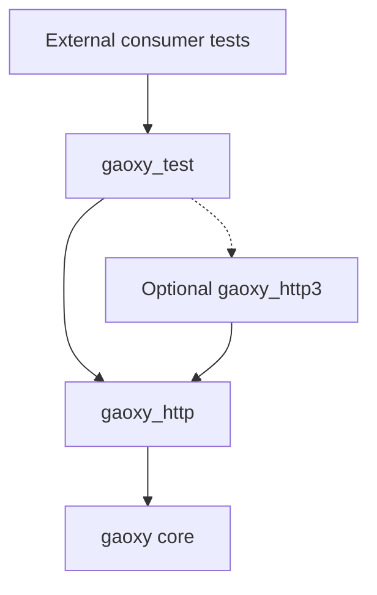
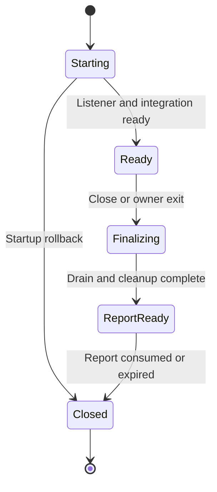

# Gaoxy Test Implementation Plan and Codex Handoff

**Repository:** https://github.com/gsmlg-dev/gaoxy  
**Prepared:** 2026-10-21, Asia/Shanghai  
**Reviewed baseline:** main at `656dbf5bb84564adc6a4d68247c0ad2fe52c2625`, source version 0.7.0  
**Reference consumer:** https://github.com/gsmlg-dev/http_fetch at `6b69bde3f43f2270317c38fbe68d5ac9635d3b36`, source version 0.21.14  
**Delivery:** Implement, document, test, package, and release an independently consumable `:gaoxy_test` package in the Gaoxy repository.  
**Status:** The user accepted the package direction and requested this development plan. The new APIs below are implementation contracts, not claims that the package already exists.

### Execution checklist — 2026-10-21

The original phase requirements below remain unchanged. The checkout was
reconciled with newer remote 0.8.0 source as recorded below. The user-provided
plan was initially untracked; no reset, new branch, worktree, or unrelated edit
occurred. Implementation is present but integrated acceptance remains incomplete.

- [x] Read the complete plan and current repository instructions.
- [x] Inspect actual checkout, public lifecycle APIs, package manifests, curated
  gates, consumer patterns and exact-source release workflow.
- [x] Write initial shared API/ownership/deadline contracts in
  `docs/testing/gaoxy-test-design.md` before implementation dispatch.
- [x] Complete Phase 0 independent specification review and frozen contracts.
- [ ] Commit the scoped implementation checklist with the reviewed delivery.
- [x] Phase 1: package, H1/HTTPS and isolated ExUnit proof passed independent
  lifecycle review and fresh canonical aggregate verification.
- [x] Phase 2: actual H2, counts and SSE tests passed; cleanup and report-freezing
  findings were repaired and independently accepted.
- [x] Phase 3: optional H3, absence proof and H1 WebSocket helpers passed
  independent protocol review and fresh canonical verification.
- [ ] Phase 4: consumers, packaging, isolation and CI/release gates implemented;
  staged consumers, final standalone isolation and local gates pass; hosted
  execution pending.
- [ ] Phase 5: independent review, aligned versions, fresh required verification,
  commits/push/integration, publication and fresh Hex-only consumer.

**Historical BLOCKED_ENV (resolved 2026-10-22):** the required `sol_worker` runtime could not start because its
configured model `gpt-6.1-sol` is unavailable. No implementation worker started;
repair counters remain zero. No model substitution was attempted. The initial
packaging baseline passed 9 tests; this is not evidence for the unimplemented
package. See `docs/acceptance/gaoxy-test.md` for exact evidence and outstanding
acceptance rows. On 2026-10-22 the original named role successfully allocated
the core and protocol workers without a model override. Implementation resumed;
repair counters started at zero. Current cumulative repair counters and escalation
evidence are in `docs/testing/gaoxy-test-design.md`; the overall objective remains
active and incomplete.

**Source reconciliation 2026-10-22:** remote main and published packages advanced
to 0.8.0 during the blocked period. Local main was fast-forwarded to
`32933790457bcfa3533e40dc2ae4d51ad91aa86d` without resetting or stashing task
changes. Preserve its ListenerSet/Gateway/activation and deadline fixes. Final
version selection and all required fresh verification follow independent review.

**Second source reconciliation 2026-10-22:** remote main advanced to
`044e1cd90ddf4cc1550df99411f2906209387f5f` (0.9.0) during bounded recovery. After
the worker confirmed all commands finished and writes stopped, the coordinator
saved the complete tracked patch and file copies, verified that no incoming path
collided with untracked task files, fast-forwarded main, and reapplied the task
changes through a three-way merge. The sole workflow conflict retained both
upstream internal-request gates and new helper/consumer gates. No reset, stash,
worktree or history rewrite occurred. Independent review accepted the recovery;
root/all applications and published-package examples now target 0.10.0. Fresh
integrated-source verification is in progress; no publication is claimed.

## 1. Mission and completion target

Build a real HTTP test server for Elixir applications, using Gaoxy's existing server implementations. Expose it as `Gaoxy.Test` in a new `apps/gaoxy_test` application and independently published Hex package.

The package provides Bypass-style request expectations, request observation, reliable ExUnit verification, and temporary server lifecycle management. Gaoxy's HTTP layers provide the server role for which a test suite might otherwise start Cowboy. Exact compatibility with Cowboy handlers or every Bypass API is not required.

A consumer must be able to install `gaoxy_test` as an `only: :test` dependency, start an isolated fixture, exercise it through a real client, and receive a reliable test failure for missing, excessive, unexpected, or failing requests. Public helper modules must live under `lib` and work when compiled as a dependency.

Complete all phases in this plan. H1/HTTPS is the first milestone, not the final delivery. Required delivery includes H2, opt-in H3, ordinary streaming/SSE, H1 WebSocket helpers, external consumers, and package/release integration.

This execution is centered on the Gaoxy repository. Demonstrate HTTPFetch consumption through an isolated integration project inside Gaoxy. A wholesale rewrite of HTTPFetch's existing test suite is a separate downstream migration.

## 2. Existing foundations and constraints

Reconcile this baseline with the actual checkout before editing. Preserve newer fixes and concurrent work.

| Existing foundation | Relevant behavior | Implementation consequence |
| --- | --- | --- |
| `apps/gaoxy_http/lib/gaoxy/http.ex` | Public startup, child specification, service specification, Plug/native endpoint support, loopback and port-zero defaults, H1/H2 and TLS | Reuse its public service API; do not implement another HTTP parser |
| `apps/gaoxy_http3/lib/gaoxy/http/http3.ex` | Separate opt-in H3 service facade | Resolve it only when H3 is explicitly requested |
| `apps/gaoxy_http/lib/gaoxy/http/plug_endpoint.ex` | Captures Plug exceptions and returns HTTP errors | The test wrapper must record callback failures before they become server responses |
| `apps/gaoxy_http/test/http_network_test.exs` | Existing body, streaming, file, status and TLS fixture scenarios | Reuse small scenarios and public lifecycle patterns |
| `apps/gaoxy_http3/test/plug_body_network_test.exs` | Loads a shared Plug fixture from the HTTP app's test directory | There is a concrete shared-fixture need; avoid adding a reverse package dependency |
| `scripts/generate-fixtures.sh` | Produces a test CA and localhost/IP-valid certificate | Reuse its trust model for packaged test certificate support |
| `scripts/stage-hex-packages.exs` | Fixed package list; rewrites workspace dependencies into publishable Hex dependencies | Add the package and deliberately support preservation of the optional H3 flag |
| `.github/workflows/test.yml`, `scripts/check-repairs.py` | Curated test selection rather than automatic execution of every added test | Explicitly add a gate for the new package |
| `.github/workflows/release.yml` | Exact-source/version validation, package arrays, build and publication | Include the new package in both build and publish arrays |

HTTPFetch already has a Go HTTP fixture, raw HTTP/2 peers, SSE/WebSocket socket fixtures, and independent protocol peers. It does not currently depend on Bypass or Cowboy. The new package provides a reusable alternative for future and selected existing tests; there is no assumed Bypass dependency removal in HTTPFetch.

The earlier unified-listener/Gateway design is contextual, not a prerequisite. At the reviewed baseline, `Gaoxy.HTTP.ListenerSet`, `Gaoxy.HTTP.ListenerProvider`, and `Gaoxy.Proxy.Gateway` were not implemented. Start with the public service specifications that exist. If these APIs have since landed, integrate through their documented contracts without reopening their architecture.

## 3. Package boundaries

### 3.1 Allowed dependency direction

The new package depends on `gaoxy_http`; H3 support uses an explicitly optional `gaoxy_http3` dependency. A direct core dependency is appropriate only where required by the public APIs used.

Keep `gaoxy_proxy`, `gaoxy_server`, `http_fetch`, and `http_web_socket` outside the test package's runtime dependency closure. The existing proxy package already depends on HTTPFetch. Client dependencies belong to isolated consumer test projects.

Keep production applications independent of `gaoxy_test`. In particular, adding an `only: :test` back-edge from `gaoxy_http` to `gaoxy_test` still creates a package cycle. Lower-level server tests stay with their server package; new high-level fixture tests live in the new package or external integration projects.

### 3.2 Application and compilation

- Provide a small application supervisor containing an application-owned DynamicSupervisor for fixture instances.
- Start no listener merely because the application starts.
- Public APIs, adapters, and runtime assets belong in `lib` and `priv`, not in `test/support` or a test-only compilation branch.
- Keep ExUnit integration in a thin adapter. Never call `ExUnit.start()` on behalf of the consumer.
- The normal consumer dependency uses `only: :test`. Do not automatically add `runtime: false`: the fixture supervisor must be started.
- H1/H2 consumers must compile and run with H3 modules physically absent. Avoid unconditional struct expansion or compile-time requirements on H3 code.
- The standalone Gaoxy release and an external consumer's production release must exclude `gaoxy_test` and its ExUnit integration.

## 4. Public API contract

Freeze names and return shapes during Phase 0. Prefer the following small interface; adjust naming only where repository conventions clearly require it, and update the whole plan consistently.

| API | Required semantics |
| --- | --- |
| `Gaoxy.Test.open(options)` | Return an opaque fixture handle after startup is ready; default to per-test ExUnit integration; setup errors raise a useful fixture setup error |
| `open(mode: :manual, ...)` | Same server without ExUnit hooks; works without starting the ExUnit application or runner |
| `url(server, path)` | Return the actual usable URL based on the bound address and port; default path is `/` |
| `info(server)` | Return selected profile, actual endpoints, readiness, capabilities and TLS trust information |
| `expect(server, method, path, handler, options)` | Require at least one matching request by default; a positive integer `times` means an exact count |
| `expect_once(server, method, path, handler)` | Convenience form for exactly one request |
| `stub(server, method, path, handler)` | Allow zero or more matching requests without a count obligation |
| `requests(server)` | Return a bounded request journal with explicit truncation information |
| `await_request(server, matcher, timeout)` | Wait for an observed request within a finite deadline; expose a cursor/request identity to avoid accidentally reusing an old observation |
| `verify!(server, options)` | Capture a snapshot, bounded-wait for its already admitted ordinary callbacks to settle, then check obligations and failures; do not close or suppress final verification |
| `verify_and_close!(server, options)` | Finalize once, close resources, and raise if the final report contains failures |
| `close(server, options)` | Perform bounded finalization and return its report without silently dropping failures |

Use optional/default arities where idiomatic. Handles must carry per-instance identity so stale handles cannot accidentally address a replacement fixture. Avoid dynamically generated registered atoms and fixed ports.

Automatic mode is intended for a test body or per-test `setup`. Document automatic per-test expectations in `setup_all` as unsupported; shared fixtures require explicit manual lifecycle and verification. Do not inspect private ExUnit internals to detect setup context.

### 4.1 Matching and expectation semantics

Start with exact HTTP method and request-path matching. Normalize methods consistently; match path separately from the query string. Assertions on query, headers, and body belong in the callback. An explicit catch-all may be supported, with exact routes taking precedence.

Use one active definition per exact route in the first release; reject ambiguous duplicate definitions with a clear error. Do not introduce a generalized matcher language or implicit response-sequence ordering.

- `expect`: one or more matching requests.
- `expect_once`: exactly one.
- `times: n`: exactly n, where n is a positive integer.
- `stub`: zero or more.
- No matching route: record an unexpected-request failure.
- Exhausted exact-count expectation: record an excessive-request failure, even if a fallback stub exists.
- Registering a handler after fixture finalization starts is an error.
- Returning an invalid callback result is a handler failure, not a successful expectation.

Count requests when admitted and matched, independently of response completion. Cancellation does not refund a consumed request. Track callback completion, failure, and cancellation separately.

Do not promise a global request order across concurrent H2/H3 streams. Tests requiring order must use explicit events or barriers.

### 4.2 Request and response handling

The initial handler interface is a normal unary Plug callback. Preserve Plug's ordinary body-reading and response APIs. Provide small response helpers for common status/header/body, redirect and streaming cases where they reduce boilerplate.

The fixture must not eagerly consume or buffer every request body for matching. Default journal entries contain metadata, request identity, outcome, and actual protocol where available. Preserve repeated headers as a list. Full-body capture is opt-in and size-limited; truncation is visible.

Keep journal bounds independent from verification accounting. Dropping an old display entry must never drop an unmet expectation, overflow failure, callback exception, or active-request record.

Use event-driven waiting. Keep the initial await matcher structured and bounded, such as exact method/path and a request cursor; arbitrary user predicates must not execute inside the coordinator. Configurable response delays are valid test behavior; fixed sleeps used to guess readiness or request completion are not.

## 5. Internal architecture and lifecycle

### 5.1 Functional core and process shell

Keep normalization, route matching, expectation transitions, and report construction as pure functions. The per-fixture coordinator owns mutable state, atomic admission, waiters, and lifecycle. Execute user callbacks in the existing request execution context outside the coordinator.

A practical module split is:

| Module group | Responsibility |
| --- | --- |
| `Gaoxy.Test` and handle types | Public facade and validated options |
| `Gaoxy.Test.Expectations` | Pure matching, reservation, terminal outcomes and reports |
| `Gaoxy.Test.Instance` | Per-fixture coordinator, owner monitoring, finalization and bounded journal |
| `Gaoxy.Test.DispatchPlug` | Bridge from real requests into expectation admission and callback execution |
| `Gaoxy.Test.Server` or a small adapter module | Public Gaoxy startup, endpoint discovery and shutdown |
| `Gaoxy.Test.ExUnit` | Hook registration and failure reporting |
| TLS, SSE and WebSocket helpers | Small protocol-aware helpers built on existing public APIs |

Names are illustrative until Phase 0 freezes them. Avoid a persistent result database, global scenario engine, or additional process layers without a concrete ownership need.

### 5.2 ExUnit ownership

ExUnit terminates the test process and its test-supervised children before running `on_exit` in another process. Consequently, the expectation ledger must remain available beyond that boundary. See the official [ExUnit lifecycle documentation](https://hexdocs.pm/ex_unit/ExUnit.Callbacks.html).

Use this lifecycle:

1. Create a per-fixture coordinator under `gaoxy_test`'s application-owned DynamicSupervisor with `restart: :temporary`.
2. Monitor the test owner; do not link the coordinator to the test process or put the only copy of verification state under the test supervisor.
3. Start the listener subtree through supported Gaoxy APIs and obtain its actual bound address.
4. Register one `on_exit` callback using the fixture identity. If hook registration fails, close all resources created by startup before raising.
5. Return the fixture only when startup and hook registration are complete.
6. Owner `DOWN` starts bounded finalization and closes network resources, while retaining the final report for the hook.
7. The hook obtains the same final report, disposes retained state, and reports failures to ExUnit.
8. If the hook arrives first, it initiates the same finalizer. Concurrent close, owner-down and hook requests join one finalization operation.

Normal ExUnit owner shutdown is not itself a fixture failure. A coordinator crash must not restart the fixture with empty expectations. If state becomes unavailable, verification fails with an infrastructure error.

Retain abandoned final reports for a finite configurable period. Expired/missing state must never be interpreted as successful verification. Keep the coordinator/report alive only as long as required; all network resources must already be closed.

Manual mode uses the same ownership and shutdown machinery, without automatic ExUnit reporting. The caller explicitly verifies and closes. Owner death cleans resources but cannot be described as successful manual verification.

### 5.3 Finalization

Finalization seals expectation changes and new admissions, resolves already admitted callbacks within one absolute monotonic deadline, stops listeners and owned workers, and freezes a report. While the report is retained, repeated calls return or join the same result. After disposal or expiry, stale handles return a clear closed/expired error and can never produce a successful verification.

Implement finalization as a nonblocking coordinator state. It must continue processing terminal callback messages, monitors and deadline events while draining. Blocking backend shutdown work may run in a monitored worker; do not synchronously drain inside a GenServer callback while request workers need to call that same coordinator to report completion.

Use public shutdown APIs. Do not assume that TCP, TLS and QUIC share pause/resume behavior. Late requests rejected by a sealed fixture cannot acquire expectations.

Always attempt cleanup when verification fails. An ordinary unfinished callback at the deadline is a test failure. Report cleanup uncertainty or a cleanup failure explicitly instead of claiming all sockets closed. Listener/runtime ownership must ensure a crashed coordinator cannot leave a live server subtree behind.

Every explicit terminal API in automatic mode, including `close` and `verify_and_close!`, must leave its final report available for the automatic hook. Manual mode retains a terminal report for the documented bounded retention period so immediate repeated finalization calls remain deterministic.

`verify!` captures the admitted requests belonging to its snapshot and bounded-waits for their ordinary callbacks to settle. Pending callbacks at its deadline produce a pending/timeout error, never success based solely on consumed counts. Established declared persistent sessions follow their explicit session policy. Requests admitted after the snapshot remain subject to final verification; an earlier snapshot check cannot waive their later errors.

### 5.4 Atomic concurrency and callback failures

For each request, atomically select and reserve an expectation, allocate a request identity, and return the selected handler. Run it outside the coordinator; record its terminal outcome before declaring it settled.

Wrap callback exceptions, throws and exits. Preserve the original exception and stacktrace. Monitor unresolved execution contexts so abrupt termination cannot leave a request looking successful.

A single assertion failure should retain its original useful location; multiple failures need a readable report keyed by request and expectation. Final verification must fail even when the client considers the resulting HTTP 500 an acceptable response.

## 6. Protocol and streaming scope

### 6.1 Profiles

Prefer one selected protocol profile per fixture in the first release.

| Profile | Transport and required behavior |
| --- | --- |
| `:http1` | Plain TCP HTTP/1.1 |
| `:https` | TLS HTTP/1.1 with explicit trusted test CA |
| `:h2c` | Cleartext HTTP/2 prior knowledge |
| `:http2` | TLS HTTP/2 through ALPN; require actual H2 use |
| `:http3` | QUIC HTTP/3 using optional `gaoxy_http3`; explicit dependency and certificate preflight |

Use the existing `Gaoxy.HTTP.service_spec/1`, `Gaoxy.HTTP.HTTP3.service_spec/1`, and public Gaoxy lifecycle/inspection APIs. Profiles must not silently fall back to another protocol. A configured protocol label alone is not evidence of the negotiated protocol.

H3 continues to use a normal HTTPS URL with the correct UDP endpoint and client protocol selection; do not invent an `http3://` URL scheme.

Mixed H1/H2 listeners can be added when a consumer needs them. H1 Upgrade-to-h2c and coordinated same-number ephemeral TCP/UDP allocation are outside this package's initial contract.

### 6.2 TLS and optional H3

Ship dedicated test CA/leaf assets under `priv`, or an equally self-contained supported fixture mechanism. Reuse the existing SAN and verification approach. Locate packaged assets through application-relative APIs, never repository-relative paths.

Consumers should receive the CA/trust configuration needed for hostname verification. Ordinary tests should not require disabled certificate verification or a locally installed certificate generator.

When H3 is requested but unavailable or unsupported, fail before readiness and release anything allocated during startup. Use a small explicit adapter resolution path; a generalized plugin registry is unnecessary.

### 6.3 Streaming, SSE and WebSocket

Require finite streamed responses and SSE over each supported HTTP profile where the existing server supports ordinary streaming. Supply event-based observation so tests can wait for headers, an emitted event, completion, or cancellation.

Require an H1 WebSocket helper using the existing public upgrade/WebSock integration. Support basic echo, send/receive observation, controlled close, and resource cleanup. H2/H3 extended-CONNECT WebSocket helpers are a follow-up unless their existing public paths can be reused directly with bounded extra work; do not grow this task into implementing a missing protocol feature.

Persistent sessions need an explicit terminal policy:

- A finite handler/session must complete within the fixture deadline.
- A declared persistent SSE/WS helper may be cancelled by fixture shutdown after it has successfully established the session.
- Failures before establishment and ordinary blocked Plug callbacks still fail.
- Preserve assertions and observed failures when cancelling an established session.
- Do not introduce a global option that ignores unfinished handlers.

Bypass-style `down/up` is a follow-up unless a current consumer requires it. If added, it must preserve expectation identity and define treatment of existing connections through supported lifecycle APIs. It is distinct from final `close`.

## 7. Reuse and migration

Reuse existing scenarios and public setup patterns; extract only genuinely shared pieces. Keep protocol-specific lower-level fixtures where their wire control is needed.

| Test purpose | Direction |
| --- | --- |
| Ordinary responses, uploads, redirects and request assertions | Prefer the new package in new and selected migrated integration tests |
| Streaming, SSE and normal WebSocket interaction | Share the new observation and lifecycle helpers |
| Deliberately invalid framing, illegal frames and exact reset timing | Preserve scripted/raw peers |
| Independent protocol interoperability | Preserve Go, Python, Node and other independent implementations |

Do not make production Gaoxy code emit invalid frames merely to replace a raw test peer. Do not remove independent peers because Gaoxy and HTTPFetch can communicate successfully.

The first HTTPFetch adoption is `integration/http_fetch_test_consumer` in this repository. It should prove actual public-client use, not require editing HTTPFetch's repository. Document downstream migration candidates after this check passes.

## 8. Implementation phases

### Phase 0 — Reconcile the checkout and freeze contracts

1. Read current `AGENTS.md`, source status, manifests, release tooling and relevant public lifecycle APIs.
2. Create an isolated `codex/gaoxy-test` worktree under the repository's `.trees/` directory when needed; preserve unrelated work.
3. Write `docs/testing/gaoxy-test-design.md` and commit the implementation checklist at `docs/plans/gaoxy-test.md`.
4. Freeze API names, profile names, expectation semantics, report shape, ownership and finalization deadlines.
5. Decide module ownership before parallel implementation.
6. Reuse newer unified-listener work if available; do not make it a hidden prerequisite.

**Exit:** an acyclic package plan and a small agreed public contract, with no assumed API that is absent from the checkout.

### Phase 1 — Package skeleton, expectations, lifecycle and H1/HTTPS

1. Add the application, public facade, pure expectation state, coordinator and DispatchPlug.
2. Implement exact route matching, count semantics, stubs, request journal and finite waiting.
3. Implement automatic and manual ownership, startup rollback, callback failure propagation and finalization.
4. Add H1/HTTPS profiles and packaged trust material.
5. Add behavior tests for missing/excess/unexpected requests, assertion propagation, isolation, owner termination and cleanup.
6. Use small isolated ExUnit subprocess suites to prove that automatic verification actually changes test results.
7. Update docs with public usage examples and deliberate compatibility differences.

**Exit:** an external test can use a real HTTP client, and both success and expected failure cases are reported correctly with bounded resource cleanup.

### Phase 2 — H2, streaming and SSE

1. Add h2c prior-knowledge and TLS H2 profiles.
2. Reuse the same expectation state and finalizer; avoid protocol-specific expectation engines.
3. Prove simultaneous streams on one connection can execute independently.
4. Prove two requests competing for an exact-once expectation cannot both execute its callback.
5. Add finite streaming/SSE helpers and explicit persistent-session termination semantics.
6. Verify actual protocol use through public observation plus an independent peer.

**Exit:** H2 multiplexing preserves count/failure semantics and one blocked stream does not serialize unrelated callbacks.

### Phase 3 — Optional H3 and H1 WebSocket

1. Add optional H3 resolution and early capability/dependency errors.
2. Add real H3 request, upload/response, streaming and cleanup checks using trusted certificates.
3. Add H1 WebSocket helper and bounded persistent-session cleanup.
4. Prove optional H3 absence in a clean external consumer.
5. Record the exact supported protocol/helper combinations in README and `info/1`.

**Exit:** the ordinary consumer runs without H3 dependencies; the explicit H3 consumer uses actual H3; WebSocket establishment, interaction and shutdown are observable.

### Phase 4 — External consumers, packaging and CI

1. Add isolated base, H3 and HTTPFetch consumer fixtures.
2. Add `gaoxy_test` to staging metadata and preserve optional H3 semantics.
3. Run a consumer against staged package sources or extracted tarballs, including packaged `priv` assets.
4. Wire dedicated nonempty new-package and consumer gates into CI and release verification.
5. Verify production dependency/release isolation.
6. Update repository documentation and package listing.

**Exit:** package contents and actual external behavior are verified, and CI executes the new tests explicitly.

### Phase 5 — Review, integration and release

1. Perform independent review of lifecycle/concurrency and package/dependency boundaries.
2. Fix actionable findings and select the next appropriate project version after checking current tags and concurrent changes. Keep root and all release applications aligned under the existing process.
3. Verify the final versioned source using affected gates, staged-package consumers and established required release verification. Any subsequent code, dependency, packaging or version change invalidates the affected evidence and requires a focused rerun.
4. Complete `docs/acceptance/gaoxy-test.md` with the validated source identity, exact commands, nonzero executed counts, results and supported capabilities. Identify any evidence-only documentation commit separately; publish the exact pre-versioned commit accepted by the release workflow's final verification.
5. Follow the owner's standing completion workflow: scoped commits, push, integration through the repository's normal flow, and release/publication after required gates pass.
6. Verify the published `gaoxy_test` package from a fresh Hex-only consumer without local path overrides.
7. Report commit, CI, tag, GitHub release and Hex package identities separately.

**Exit:** the usable package is delivered through the established release workflow, or a concrete external publication blocker is reported with all unaffected work complete. A local build is not a published package.

## 9. File and integration ownership

The paths below distinguish existing files from proposed additions.

| Area | Paths | Status |
| --- | --- | --- |
| Package | `apps/gaoxy_test/mix.exs`, `lib/`, `priv/`, `test/`, README and formatter | New |
| Design | `docs/testing/gaoxy-test-design.md` | New |
| Execution checklist | `docs/plans/gaoxy-test.md` | New |
| Verification evidence | `docs/acceptance/gaoxy-test.md` | New |
| Base external consumer | `integration/test_consumer/` | New |
| Explicit H3 consumer | `integration/test_h3_consumer/` | New |
| HTTPFetch consumer | `integration/http_fetch_test_consumer/` | New |
| Consumer runner | `scripts/test-consumers.sh` or a naming-consistent equivalent | New |
| Package staging | `scripts/stage-hex-packages.exs` | Existing |
| Staging regressions | `scripts/test-stage-hex-packages.py` | Existing |
| Test gates | `.github/workflows/test.yml`, `portable.yml`, existing scoped test wrappers | Existing |
| Release gates/publication | `.github/workflows/release.yml`, root/app manifests, release docs | Existing |

Do not treat this list as permission for broad cleanup. Small necessary production API repairs are in scope when supported by a reproduced need; identify and verify them separately.

## 10. Packaging and release requirements

### 10.1 Staging

The current staging script accepts an internal umbrella dependency only when its options are exactly `[in_umbrella: true]`. Adding `optional: true` therefore requires an explicit converter change.

Extend the supported normalization narrowly:

- Preserve application/Hex package identity and exact aligned internal versions.
- Preserve `optional: true` for `gaoxy_http3`.
- Continue rejecting unknown path/git/override combinations.
- Add `gaoxy_test` to package and description lists.
- Include public modules, README/license and all required `priv` assets.
- Add metadata assertions and unsupported-option regression coverage to the existing staging tests.

Workspace success does not establish optional dependency correctness. The umbrella already contains H3.

### 10.2 CI

The current unit workflow runs a curated `scripts/check-repairs.py unit` selection. Add a dedicated `gaoxy_test` gate or a deliberately scoped extension to its suite map. Use the existing nonzero-test checks; do not edit unrelated historical expected counts.

Ensure release verification also invokes the new gates. Set the test environment explicitly when called from the release workflow, which otherwise uses production build settings.

Keep the repository's existing supported build matrix and canonical formatter. Preserve exclusions for deferred sustained-load and other specialist qualification; this feature does not reopen them.

### 10.3 External consumers

| Consumer | Required proof |
| --- | --- |
| Base consumer | Public H1/HTTPS/H2 helper works without H3, QUIC, ExSSL, proxy, standalone or HTTPFetch dependencies |
| H3 consumer | Explicit H3 dependency produces a real H3 exchange and releases the listener |
| HTTPFetch consumer | Released/public HTTPFetch drives the fixture and its expectations; client dependency belongs to this consumer |
| Production consumer | Test-only helper is absent from production dependency and release closure |
| Staged package consumer | Helper works without repository-relative paths; trust assets and optional metadata survive packaging |
| Published package consumer | Fresh Hex-only installation works after publication, without source overrides |

Prepublication local staging can use explicit fixture-only local dependency mappings for unreleased sibling packages. Document that condition; it is not equivalent to the post-publication Hex-only proof.

### 10.4 Release integration

Add `gaoxy_test` to both fixed package arrays in `release.yml`: artifact building/checksums and publication/verification. Place it after the dependencies required by its publication path.

Preserve exact-SHA validation, precommitted version checks, tarball/checksum verification, and tagging of the validated commit. The current version gate already checks every `apps/*/mix.exs`.

Inspect the resulting standalone release closure. Adding a package to an umbrella must not cause the test helper or ExUnit to ship inside the production Gaoxy release.

If publication is interrupted, inspect remote package and tag state before retrying. Keep already-published artifacts immutable and report partial publication accurately.

## 11. Acceptance matrix

Use finite real-network checks and deterministic barriers. These rows are behavior requirements, not a demand for a large new performance campaign.

| ID | Scenario | Required observable outcome |
| --- | --- | --- |
| A01 | Basic external H1 and HTTPS | Actual request/response, usable dynamic URL, successful verification, trusted TLS |
| A02 | Missing, excessive and unexpected requests | Each fails an isolated ExUnit suite with a useful route/count report |
| A03 | Callback assertion/exception | Client may receive an HTTP error, but ExUnit still fails with the original useful location |
| A04 | Parallel independent fixtures | Identical routes have independent ports, counters, journals, failures and cleanup |
| A05 | Concurrent exact-once | Exactly one callback executes; the extra request becomes a verification failure |
| A06 | Test-supervised client plus automatic fixture | Client shutdown and later on_exit verification work with the report still available |
| A07 | Setup failure after open, owner exit and abrupt coordinator termination | Fixture resources close within the deadline; preserved failures remain reportable; coordinator loss produces an infrastructure failure and never restarts empty expectations |
| A08 | Blocked ordinary callback | Teardown times out as a test failure, then releases owned resources |
| A09 | Repeated close and owner/hook race | One final report while retained, no revived listener or double-disposal crash; disposed/expired verification fails clearly |
| A10 | Manual mode | Works without ExUnit startup; explicit verification and owner-death cleanup behave as documented |
| A11 | H2 profiles | Actual h2c/H2 exchange, concurrent streams, count semantics and isolated callbacks |
| A12 | Streaming/SSE | Finite streams complete; declared persistent sessions cancel after establishment; pre-establishment errors still fail |
| A13 | H3 absent | Base consumer compiles; explicit H3 request fails clearly without leaked allocations or fallback |
| A14 | H3 present | Actual H3 request/body/stream, verified trust, public observation and bounded cleanup |
| A15 | H1 WebSocket | Successful upgrade, observed messages, controlled close, correct teardown |
| A16 | Bounded journal/body capture | Truncation is visible and does not erase verification failures or change ordinary body reading |
| A17 | HTTPFetch external consumption | Public client exercises real fixture and expectation failures correctly |
| A18 | Packaging and release isolation | Correct optional metadata/assets/version, clean staged consumer, no helper in production release |
| A19 | CI inclusion | New tests execute with nonzero count in CI and required release verification |
| A20 | Published installation | Fresh Hex-only consumer runs the documented basic workflow |

Use small subprocess ExUnit suites for cases whose expected result is test failure. Do not manipulate the running global ExUnit runner recursively.

For cleanup, assert actual listener/worker termination and socket unavailability/reusability within finite bounds. The intentional report keeper may survive until hook consumption or retention expiry; verify that it terminates at that documented boundary. Merely observing a stop message is insufficient. Run only concrete checks needed for the changed behavior and existing gates.

Keep PASS, FAIL, BLOCKED and NOT RUN distinct. An unavailable optional test prerequisite must be reported and resolved or explicitly identified as an incomplete capability; it must not silently disappear from the completion report.

## 12. Parallel execution and work discipline

After Phase 0 freezes interfaces, split independent work:

| Worker | Ownership |
| --- | --- |
| Core | Pure expectations, matching, journal and report contract |
| Lifecycle | Coordinator, owner monitoring, DispatchPlug, ExUnit integration and lifecycle tests |
| Protocols | Profiles, TLS assets, streaming/SSE and WebSocket/H3 adapters |
| Integrator | Public facade, consumer fixtures, package/CI/release integration, docs and final review |

Use as many workers as available; combine roles when necessary. Give each worker explicit file ownership. Shared API changes, root manifests, version edits, staging and release workflow edits have one coordinating writer.

Keep request/expectation logic functional. Use processes for mutable state and resource ownership, not for every data structure. Avoid unrelated refactors and broad replacement of existing test suites.

For a reproduced upstream dependency defect, follow the repository's existing dependency-issue routing with source identity and a minimal reproduction. Finish independent work while the affected capability is blocked; do not patch dependency internals or weaken assertions.

Follow the current owner's authorization and established completion workflow. Do not pause after each passing phase for routine confirmation. Do not reopen previously excluded qualification campaigns or change account/repository settings to overcome hosted-run limits.

## 13. Required final delivery report

The implementation report must contain:

1. Public installation and usage examples for automatic and manual mode.
2. Supported protocol/helper matrix and explicit limitations.
3. Architecture and lifecycle explanation, including assertion propagation and concurrent count handling.
4. Existing fixture reuse and downstream migration candidates.
5. Exact verification commands, source identity, executed counts and outcomes.
6. Staged and external-consumer results, including H3 absence and production release isolation.
7. Commit/push/CI/tag/GitHub release/Hex status with identifiers.
8. Any concrete remaining blocker, affected capability, and next action.

Update the human-readable architecture and acceptance documents rather than producing a stream of per-worker completion notes. Preserve existing independent-peer evidence and distinguish implementation, verification and publication.

## 14. Codex kickoff prompt

Implement `gaoxy_test` in https://github.com/gsmlg-dev/gaoxy using this plan.

Read the current repository instructions, inspect the actual checkout, and preserve newer fixes and unrelated work. The reviewed baseline is `656dbf5bb84564adc6a4d68247c0ad2fe52c2625` (0.7.0), but do not reset to it.

Create `apps/gaoxy_test` as an independently published Hex package with the public `Gaoxy.Test` API. Use `gaoxy_http` and optional `gaoxy_http3`; keep proxy, standalone and HTTPFetch outside the package's runtime dependencies. HTTPFetch is a real external test consumer.

Complete Phases 0–5, including H1/HTTPS, H2, optional H3, streaming/SSE, H1 WebSocket helpers, reliable ExUnit verification, external consumers, package metadata, CI gates and release integration. Do not stop after creating a listener wrapper or after the first H1 milestone.

Prioritize the correctness boundaries in this plan: atomic expectation reservation, callback assertion propagation, ledger survival across ExUnit teardown, bounded finalization, explicit persistent-session termination, optional-H3 compilation, and absence from production releases.

Keep the expectation engine functional, execute user callbacks outside the coordinator, and use supported public server APIs. Preserve raw negative peers and independent interoperability suites. Do not create a reverse dependency from gaoxy_http to gaoxy_test.

Write and maintain `docs/testing/gaoxy-test-design.md`, `docs/plans/gaoxy-test.md`, and `docs/acceptance/gaoxy-test.md`. Freeze interfaces before delegating independent implementation. Use scoped real-network tests and small isolated ExUnit failure suites. Explicitly wire new tests into the existing curated CI/release process.

Follow the owner's standing completion workflow after required verification and independent review: commit, push, integrate through the repository's normal process, and release the aligned packages including gaoxy_test. Verify a fresh Hex-only consumer after publication. Report actual outcomes and any concrete blocker without claiming unexecuted checks or unpublished artifacts succeeded.

## Sources and applicability

Repository sources below are pinned to the reviewed baseline. They ground existing behavior; the new API and module contracts above are the proposed implementation.

- [Gaoxy HTTP facade](https://github.com/gsmlg-dev/gaoxy/blob/656dbf5bb84564adc6a4d68247c0ad2fe52c2625/apps/gaoxy_http/lib/gaoxy/http.ex)
- [Gaoxy Plug exception handling](https://github.com/gsmlg-dev/gaoxy/blob/656dbf5bb84564adc6a4d68247c0ad2fe52c2625/apps/gaoxy_http/lib/gaoxy/http/plug_endpoint.ex)
- [Gaoxy HTTP3 facade](https://github.com/gsmlg-dev/gaoxy/blob/656dbf5bb84564adc6a4d68247c0ad2fe52c2625/apps/gaoxy_http3/lib/gaoxy/http/http3.ex)
- [Existing HTTP network fixtures](https://github.com/gsmlg-dev/gaoxy/blob/656dbf5bb84564adc6a4d68247c0ad2fe52c2625/apps/gaoxy_http/test/http_network_test.exs)
- [Existing cross-app H3 fixture reuse](https://github.com/gsmlg-dev/gaoxy/blob/656dbf5bb84564adc6a4d68247c0ad2fe52c2625/apps/gaoxy_http3/test/plug_body_network_test.exs)
- [Proxy dependency boundary](https://github.com/gsmlg-dev/gaoxy/blob/656dbf5bb84564adc6a4d68247c0ad2fe52c2625/apps/gaoxy_proxy/mix.exs)
- [Package staging](https://github.com/gsmlg-dev/gaoxy/blob/656dbf5bb84564adc6a4d68247c0ad2fe52c2625/scripts/stage-hex-packages.exs)
- [Staging regression tests](https://github.com/gsmlg-dev/gaoxy/blob/656dbf5bb84564adc6a4d68247c0ad2fe52c2625/scripts/test-stage-hex-packages.py)
- [Unit workflow](https://github.com/gsmlg-dev/gaoxy/blob/656dbf5bb84564adc6a4d68247c0ad2fe52c2625/.github/workflows/test.yml)
- [Release workflow](https://github.com/gsmlg-dev/gaoxy/blob/656dbf5bb84564adc6a4d68247c0ad2fe52c2625/.github/workflows/release.yml)
- [Existing base consumer pattern](https://github.com/gsmlg-dev/gaoxy/blob/656dbf5bb84564adc6a4d68247c0ad2fe52c2625/scripts/http-consumer.sh)
- [Existing H3 consumer pattern](https://github.com/gsmlg-dev/gaoxy/blob/656dbf5bb84564adc6a4d68247c0ad2fe52c2625/scripts/h3-consumer.sh)
- [HTTPFetch published-file boundary](https://github.com/gsmlg-dev/http_fetch/blob/6b69bde3f43f2270317c38fbe68d5ac9635d3b36/apps/http_fetch/mix.exs)
- [HTTPFetch raw malformed-response tests](https://github.com/gsmlg-dev/http_fetch/blob/6b69bde3f43f2270317c38fbe68d5ac9635d3b36/apps/http_fetch/test/http/http1_strict_framing_wire_test.exs)
- [HTTPFetch independent H2 peer](https://github.com/gsmlg-dev/http_fetch/blob/6b69bde3f43f2270317c38fbe68d5ac9635d3b36/scripts/http2_stream_peer.py)
- [Bypass API semantics](https://hexdocs.pm/bypass/Bypass.html)
- [ExUnit lifecycle and callbacks](https://hexdocs.pm/ex_unit/ExUnit.Callbacks.html)

Related project design: Agent Note `c676efd4-a6a5-4157-879b-750f1563c0d2`, project `gaoxy`, “Unified Phoenix H1/H2/H3 and an Embeddable Gateway Runtime.” Its production-layer boundaries remain relevant; this plan adds a separate consumer-facing test package.
